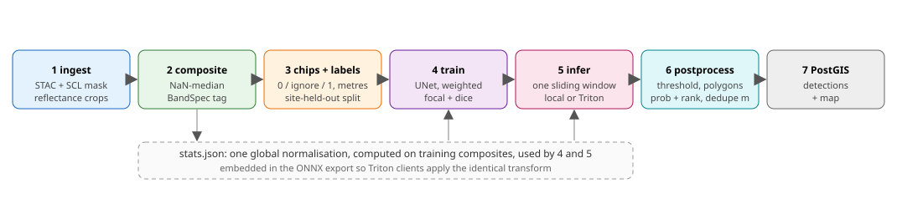
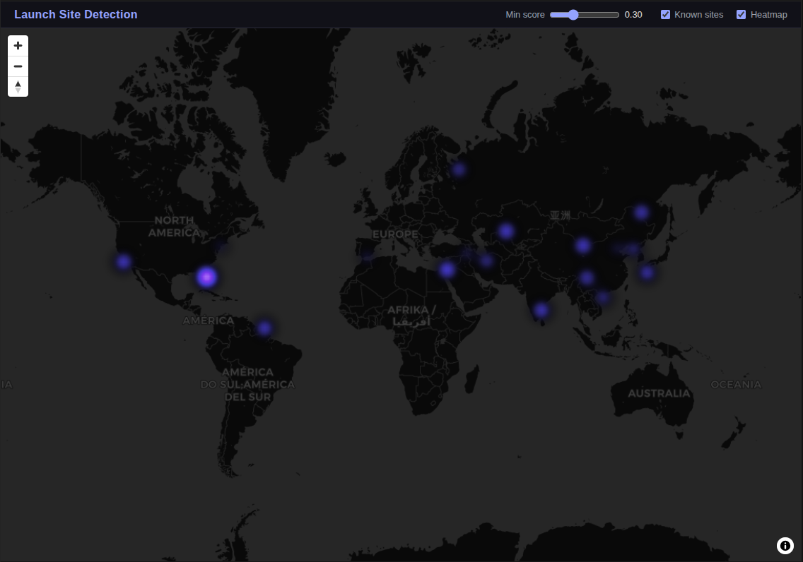
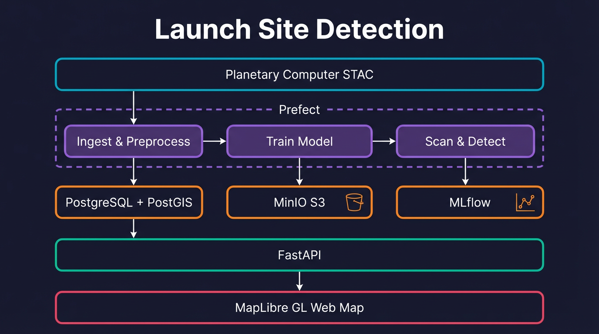

# Launch Site Detection (OSINT)

A geospatial ML pipeline that looks for rocket and missile launch sites in open Sentinel-2
imagery. It builds cloud-free reflectance composites over areas of interest, trains a UNet
segmentation model on weak labels drawn around 18 publicly documented launch sites, scans whole
composites for candidate sites, stores them in PostGIS and shows them on a MapLibre web map.
Evaluation is site-held-out; the numbers below are produced by a script in the repo.



<p align="center">
  
</p>

## Results

<!-- EVAL:START -->
_No real-data evaluation yet. `uv run python -m services.training.evaluate --update-readme README.md`
replaces this block with the validation and test results on the held-out sites._
<!-- EVAL:END -->

Until the GPU run is done this block holds the synthetic end-to-end result only:

| synthetic, not real imagery | sites | scanned km² | recall@5 | recall@10 | FP / 1000 km² | detections | runtime |
|---|---:|---:|---:|---:|---:|---:|---:|
| planted site, validation composite | 1 | 26.2 | 1.00 | 1.00 | 0.0 | 3 | 23 s (16 cores, CPU) |

Source: [`tests/integration/test_synthetic_pipeline.py`](tests/integration/test_synthetic_pipeline.py).
Two synthetic 10-band composites, each with one planted bright square "site", are chipped,
labelled, split by site, normalised with stats from the training composite only, used to train a
ResNet-18 UNet for two epochs on CPU, then scanned with the same sliding window and
postprocessing that production uses. All three detections on the validation composite lie on the
planted site. This proves that the stages fit together; it says nothing about detection skill on
real imagery.

## What changed in v0.2 and why

- **Radiometry is consistent.** Clouds are masked from the SCL band at ingest, digital numbers
  become reflectance with the per-scene scale and offset, and composites are NaN-medians tagged
  with their band order. v0.1 mixed raw DNs, clouds and per-tile stretches.
- **One normalisation.** Per-channel statistics are computed once from training composites and
  used unchanged in training, evaluation, local inference and the ONNX export.
- **Labels are in metres.** Circles around known sites are drawn in a local azimuthal equidistant
  projection with a positive core, an ignore ring (loss weight 0) and negatives beyond; v0.1 drew
  them in degrees.
- **Splits hold out whole sites.** Three test and three validation sites with a 20 km exclusion
  zone, and 17 AOIs so that every one of the 18 sites has imagery. v0.1 split random tiles, so
  neighbouring tiles of the same site sat in train and test.
- **Evaluation measures what matters.** `evaluate.py` reports site recall@K, false positives per
  1000 km² and a reliability table, and the checkpoint is chosen by validation site recall.
- **One code path each.** One training loop (`fit()`), one sliding window with a pluggable
  `Predictor` (local PyTorch or Triton), one immutable `Detection` with separate `prob` and
  `rank_score`.
- **The API and map show real evidence.** Thumbnails render from the stored composite
  (`?mode=rgb|nir`), vector tiles filter on `min_score`, known sites are seeded into the database.
- **Less code, more tests.** Sentinel-1, the dual-encoder model and the async Triton client are
  gone; unit tests, a synthetic end-to-end test, PostGIS API tests and CI were added. The
  end-to-end test found a real bug: UTM chip bounds were read as lon/lat by the split assignment.

## Data

Sentinel-2 L2A from the [Microsoft Planetary Computer](https://planetarycomputer.microsoft.com/api/stac/v1)
STAC API: blue, green, red, NIR (10 m) and SWIR 1.6/2.2 µm (20 m, resampled to 10 m).

Processing chain:

1. **Ingest.** STAC search per AOI and date range; each scene is cropped to the AOI and its SCL
   band is read alongside. Pixels outside the clear classes (4 to 7) become NaN at ingest.
   Digital numbers become reflectance with `scale_offset_for`: DN × 1e-4, with an offset of −0.1
   for processing baseline 04.00 and later (Planetary Computer items carry no `raster:bands`, so
   the baseline decides).
2. **Composite.** Per-pixel NaN-median over the scenes of an AOI. Every composite carries a
   `BANDSPEC` tag with the band names in order; readers refuse untagged composites.
3. **Normalise.** `data/manifests/channel_stats.json` holds per-channel p2/p98 and the mean and
   standard deviation after clipping, computed on training-AOI composites only. One function,
   `normalize(array, stats)`, clips each channel to its p2/p98 range and standardises it. Four
   spectral indices (NDVI, NDWI, NDBI, BSI) are computed from reflectance first, giving 10 input
   channels.
4. **Chips and labels.** 256 × 256 px chips (2.56 km at 10 m) with 32 px overlap. Each label is a
   GeoTIFF on the chip's grid with values 0 (negative), 0.5 (ignore) and 1 (positive). The
   positive disc has the site's `buffer_km` radius (1 to 5 km, default 2 km); the ignore ring
   extends to twice that radius and gets loss weight 0. Circles are drawn in metres in a local
   azimuthal equidistant projection.
5. **Splits.** Defined by site in [`data/manifests/splits.json`](data/manifests/splits.json).
   Test: Satish Dhawan, Tanegashima, Guiana. Validation: Xichang, Plesetsk, Sohae. The remaining
   12 sites are for training. A chip within 20 km of a site follows that site's split; each AOI
   belongs to one split. The 17 AOIs are in [`data/manifests/aoi_config.json`](data/manifests/aoi_config.json).

See the [dataset card](docs/dataset-card.md) for details.

## Model

Unchanged architecture: a UNet with a ResNet-34 encoder (ImageNet weights) from
`segmentation-models-pytorch`, 10 input channels, one logit per pixel; DeepLabV3+ is an option.
The loss is focal (α 0.25, γ 2) plus 0.5 × soft Dice, both weighted per pixel so the ignore ring
contributes nothing; there is no label smoothing. AdamW (lr 1e-3, weight decay 1e-4),
ReduceLROnPlateau, flips and 90° rotations. The checkpoint monitor is `val/site_recall@10` on the
validation AOIs' composites (it falls back to `val/loss` when no validation composites are
given), with early stopping on the same metric. Site-level validation runs on a single device
(global rank 0) and fails the run if it breaks. See the [model card](docs/model-card.md).

```bash
uv run python -m services.training.train_cli --manifest data/manifests/chip_manifest.json \
  --stats data/manifests/channel_stats.json --epochs 40 --gpus 1 --precision 16-mixed \
  --val-composite data/composites/xichang_composite.tif  # repeat per validation AOI
```

## Evaluation

`services/training/evaluate.py` runs the production sliding window and postprocessing over the
composites of a split and compares the detections with that split's known sites. A detection
matches a site when its centroid is within 5 km.

- **recall@K** (K = 5, 10, 20): the fraction of the split's sites matched by at least one of the
  K highest-ranked detections (ranked by `rank_score`).
- **FP per 1000 km²**: detections that match no site, per 1000 km² of scanned composite (pixels
  with data only).
- **Reliability**: detections binned by `prob` (never `rank_score`), with the fraction of each bin
  that matches a site, to check whether the probability means what it says.

```bash
uv run python -m services.training.evaluate --checkpoint checkpoints/<best>.ckpt \
  --split val --split test --update-readme README.md
```

Results go to `out/eval/{val,test}.json`; `--update-readme` rewrites the Results block above.

## Inference and serving

There is one sliding window, `libs.inference.sliding_window.run_sliding_window`: 256 px windows
with 64 px overlap, averaged in an `Accumulator`. `memmap=True` keeps the full-size sum and count
maps on disk, so memory stays at one batch of tiles for any AOI size. Pixels whose composite has
no data (NaN) stay NaN in the probability raster. The model sits behind a
`Predictor` protocol: `LocalTorchPredictor` (in-process PyTorch, any device) or `TritonPredictor`
(NVIDIA Triton over gRPC). Postprocessing thresholds the probability raster, polygonises it,
gives each polygon its mean `prob` and a `rank_score` (probability, compactness and an area
prior) and merges detections within 2 km (DBSCAN in metres). Polygons are reprojected to
EPSG:4326 for storage; area and compactness are measured in the composite's projected CRS.

For Triton, `export_model` writes an ONNX model with a dynamic batch axis, validates it against
PyTorch, embeds the normalisation stats and band spec in the ONNX metadata and copies the stats
file next to the model:

```bash
uv run python -m services.serving.export_model --checkpoint checkpoints/<best>.ckpt \
  --stats data/manifests/channel_stats.json
docker compose -f infra/docker-compose.yml up -d triton   # needs nvidia-container-toolkit
TRITON_URL=localhost:8001 uv run python -m services.pipeline.flows detect --serving-mode triton
```

The model repository config is in [`model_repository/unet_seg/config.pbtxt`](model_repository/unet_seg/config.pbtxt)
(ONNX Runtime backend, max batch 32, dynamic batching). A benchmark harness compares local and
Triton inference: `uv run python -m benchmarks.inference_benchmark --help`.

## Pipeline, API, web

**Pipeline.** Prefect flows in [`services/pipeline/flows.py`](services/pipeline/flows.py):

```bash
uv run python -m services.pipeline.flows ingest --max-scenes 20   # STAC -> composites -> chips, labels, splits, stats
uv run python -m services.pipeline.flows train                    # fit() with the validation AOIs' composites
uv run python -m services.pipeline.flows detect                   # seed known sites, scan, postprocess, store
uv run python -m services.pipeline.flows full                     # all three
```

`detect` uses Triton when `TRITON_URL` is set or `--serving-mode triton` is given, otherwise local
PyTorch.

**API.** FastAPI on PostGIS (`uv run uvicorn services.api.main:app --reload`):

| Method | Path | Description |
|---|---|---|
| `GET` | `/health` | Status, version, detection count, Triton readiness when `TRITON_URL` is set |
| `GET` | `/detections` | Detections in a bounding box; `min_score`, `limit`, `offset`; each has `score` (rank score) and `prob` (mean model probability) |
| `GET` | `/detections/{id}` | One detection with its GeoJSON geometry |
| `GET` | `/known-sites` | Reference launch sites |
| `GET` | `/evidence/{id}` | Evidence metadata: composite path, bbox, `prob`, rank breakdown, model version, scan date |
| `GET` | `/evidence/{id}/thumbnail` | PNG cut from the stored composite; `mode=rgb` (true colour) or `mode=nir` (false colour), 64 to 1024 px |
| `GET` | `/tiles/{z}/{x}/{y}.pbf` | Vector tiles via `ST_AsMVT`, filtered by `min_score` (rank score, default 0.1) |

**Web.** A MapLibre + Vite single-page map (`cd services/web && npm install && npm run dev`):
detections from the vector tiles, a score slider, known-site and heatmap toggles, and a detail
panel with the evidence thumbnail.

**Infrastructure.** [`infra/docker-compose.yml`](infra/docker-compose.yml) runs PostGIS, MinIO,
MLflow and Triton. Settings live in [`libs/config.py`](libs/config.py) and can be overridden with
environment variables or `.env` (see [`.env.example`](.env.example)).

<p align="center">
  
</p>

## Development

```bash
uv sync --all-extras
uv run ruff check . && uv run ruff format --check .
uv run pytest -q              # unit tests + the synthetic end-to-end test, under a minute
docker compose -f infra/docker-compose.yml up -d postgres
uv run pytest -m api -q       # API tests on PostGIS, in their own <db>_test database
```

105 tests run by default and 8 API tests run with `-m api`. Coverage is gated at 80 % (89.3 %
measured) over `libs` and `services`; the API is measured separately by the API job (89 %). CI
([`.github/workflows/ci.yml`](.github/workflows/ci.yml)) has two jobs: `lint-and-unit` (ruff,
pytest with the coverage gate) and `api` (pytest `-m api` against a PostGIS service container).

[`scripts/gpu_day.sh`](scripts/gpu_day.sh) is the runbook for the first real-data run: ingest,
train, evaluate (which fills the Results block) and export.

## Hardware

The API, web map and test suite run on a laptop. Ingesting 17 AOIs needs on the order of 100 to
200 GB of disk and a good connection, and training and large-area inference want a GPU: CPU-only
runs were too slow ([issue #1](https://github.com/lbougan/launch_detection/issues/1)), so the
plan is a remote GPU with Triton rather than tuning the CPU path. Data volumes, specs and cloud
instances are in [docs/hardware.md](docs/hardware.md).

## Known limitations

- **Weak circular labels.** A disc around a coordinate is a coarse proxy for an irregular
  footprint; the ignore ring softens but does not fix this.
- **10 m resolution.** Individual pads and small sites are at or below what Sentinel-2 resolves;
  the model can only respond to compound-scale structure.
- **No real-data numbers yet.** The synthetic test proves plumbing, not detection skill. Real
  results arrive with the GPU run.
- **Triton is tested with a stub only.** The Triton predictor and client are covered by unit
  tests against a fake client, not against a running server.
- **Sentinel-1 is not included.** Radar would help under persistent cloud (Guiana, Xichang).
- **Pipeline import weight.** `services/pipeline/tasks.py` still imports rasterio at module
  level through `libs.geo`.
